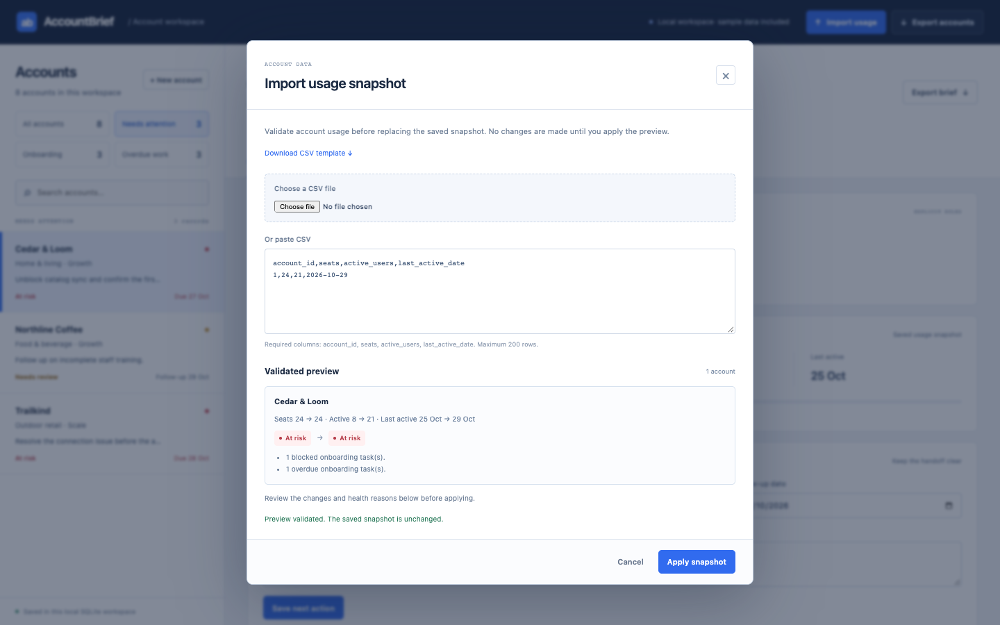

# AccountBrief

A customer onboarding and account-review workspace.

A usage export shows activity. Onboarding tasks and support issues show context. AccountBrief brings them together so an account owner can see what needs attention and leave the next person a useful handoff.


## What it does

- Create accounts with an owner, lifecycle stage and follow-up.
- Preview a usage CSV, inspect the changes and validate every row before saving.
- Explain attention flags using activity, adoption, overdue work and support blockers.
- Assign onboarding tasks, mark blocked work, complete steps and resolve issues.
- Export an account brief with current usage, outstanding work and notes, or download a filtered CSV.

## Try a complete review

Open **Cedar & Loom** and inspect its attention reasons. Update an onboarding step or resolve a support issue, then check how the account changes. Download the usage template, adjust a snapshot, preview it and apply it. Export the account brief for the next owner.

You can also create an account of your own and import its first usage snapshot.

<details>
<summary>See the usage-import preview</summary>

</details>

[Mobile workspace](docs/screenshots/mobile.png) · [45-minute walkthrough](BEGINNER_GUIDE.md) · [Review workflow](docs/PRODUCT_SUCCESS_CASE.md)

## Run locally

Python 3.11 or newer:

```bash
git clone https://github.com/JecinElizabeth/AccountBrief.git
cd AccountBrief
python3 -m venv .venv
source .venv/bin/activate
python -m pip install -r requirements.txt
python app.py
```

Open http://127.0.0.1:5062. SQLite is created under `instance/`; your changes survive restarts. To keep a separate workspace, set `ACCOUNTBRIEF_DATABASE` to another file path. `PORT` changes the port.

## Design and checks

Plain HTML/JavaScript calls Flask JSON endpoints. SQLite stores accounts, tasks, issues, notes and activity. Parameterized queries and field validation sit at the API boundary. Usage imports validate completely before a transaction commits; previews do not write.

```bash
python -m unittest discover -s tests -v
```

The browser checker covers account creation, import preview/apply, work updates, exports and mobile navigation. See `tests/browser_check.py` for its local setup. The screenshots above come from the running application and use fixed-size viewports.

## Scope

The first launch includes fictional example accounts; new records can be entered locally. Health flags are explicit rules, not AI predictions. No external service, outbound messaging or paid API is required. This local application has no login or multi-user permissions.

Maintained by [Jecin Elizabeth](https://github.com/JecinElizabeth). [MIT license](LICENSE).
