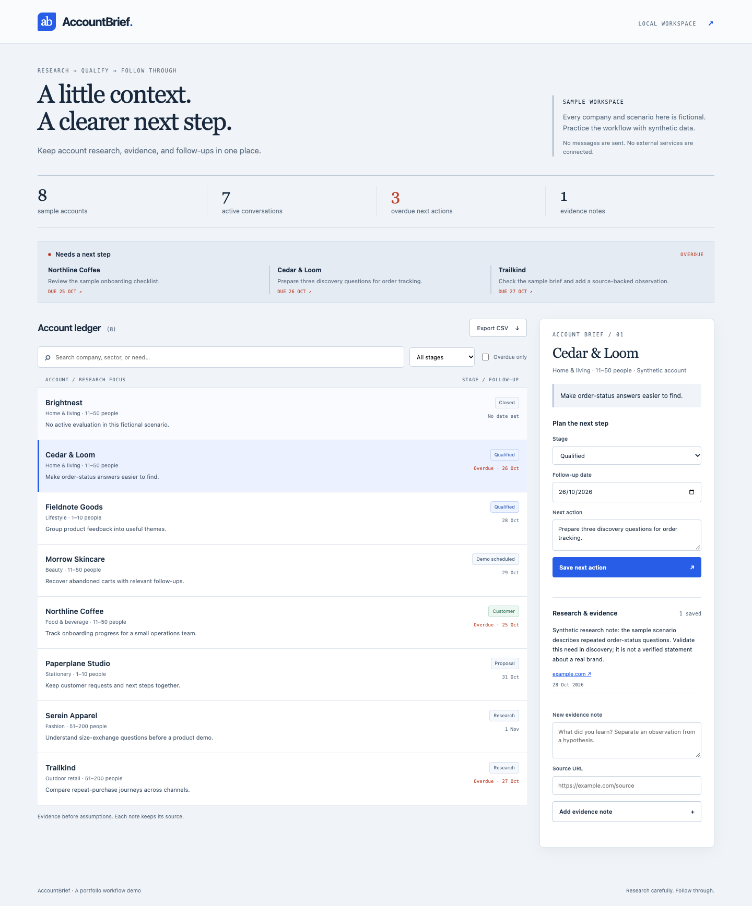
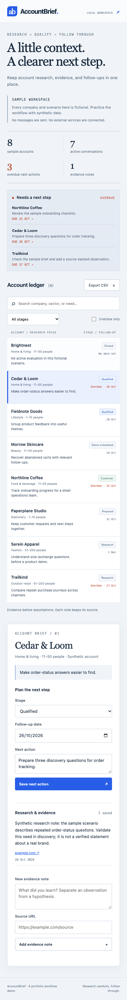

# AccountBrief

A small account-research and follow-up workspace. Search synthetic prospects, attach evidence, move an account through a pipeline, and keep the next action visible. Built to make a real browser → Python → SQL workflow understandable in one sitting.



## What works

- Search company, sector, or research focus; combine stage and overdue filters.
- Read a compact account brief and its evidence notes.
- Save a stage, follow-up date, and next action to SQLite.
- Add an observation with a validated source URL.
- See overdue follow-ups, including existing customer accounts.
- Export the filtered account ledger as CSV. Spreadsheet formula-like values are escaped.
- Use the same interface on mobile, with keyboard focus and clear empty/error states.

All seed companies, needs, notes, and scenarios are fictional. The app does not contact customers, send outreach, scrape websites, or use an AI service. A rule marks an active account overdue when its follow-up date is before today. This is a local portfolio demonstration, not a production CRM.

## Run locally

Requires Python 3.11 or newer. Installation downloads Flask and its dependencies; runtime works offline.

```bash
python3 -m venv .venv
source .venv/bin/activate
python -m pip install -r requirements.txt
python app.py
```

Open <http://127.0.0.1:5062>. The app creates `instance/accountbrief.sqlite` and seeds eight fictional accounts on its first run. Saved edits survive restarts. The database is ignored by Git. Run on localhost only; this demonstration has no login or multi-user permissions.

To choose a separate database, set `ACCOUNTBRIEF_DATABASE` to a file path before starting. `PORT` overrides the default port.

## Understand the flow

```text
Browser: filters, account form, evidence form
    ↓ HTTP / JSON
Flask: validate fields, query or update records
    ↓ parameterized SQL
SQLite: accounts table + notes table
    ↑ JSON result → interface refresh
```

| File | Responsibility |
| --- | --- |
| `app.py` | Flask routes, field validation, SQLite access, sample seed data, safe CSV |
| `templates/index.html` | Accessible page structure and forms |
| `static/app.js` | Fetch data, render text safely, save forms, apply filters |
| `static/style.css` | Responsive visual design |
| `tests/test_app.py` | API behavior, persistence, validation, filtering, export checks |

## Verify

```bash
python -m unittest discover -s tests -v
```

Tests use temporary databases and do not change your local workspace data. Eight backend tests cover combined search filters, literal wildcard handling, customer/closed follow-up behavior, persistence across app instances, rejected invalid writes, source URL validation, safe CSV cells, and response headers. Browser QA additionally exercises editing, persistence after reload, evidence notes, empty/filter/error states, CSV download, keyboard access, and mobile overflow.

The optional `tests/browser_check.py` uses Playwright and a locally installed Chrome. Install `requirements-dev.txt`, start the app with a fresh separate database path, and run `python tests/browser_check.py` in another terminal. It changes that test database and refreshes the screenshots below. Never run it against account notes you want to keep unchanged.



Read [BEGINNER_GUIDE.md](BEGINNER_GUIDE.md) for a 30–60 minute walkthrough, SQL examples, and an honest project explanation.

Two short practice cases connect the working demo to business workflows:

- [BDR practice case](docs/BDR_PRACTICE_CASE.md): discovery questions, evidence versus hypotheses, qualification criteria, and unsent sample outreach.
- [Product-success practice case](docs/PRODUCT_SUCCESS_CASE.md): onboarding, feedback-to-action examples, ownership, and acceptance checks in the app.

Both cases are explicitly fictional exercises and make no customer or sales outcome claims.

## Boundaries and next steps

The Flask development server is for local use. There is no authentication, user ownership, audit history, sales forecasting, email delivery, or external verification of research. Source URLs are stored as references; the server never fetches them. Adding real team usage would require authentication, authorization, migrations, backups, production hosting, and operational review.

## License

MIT; see [LICENSE](LICENSE).
